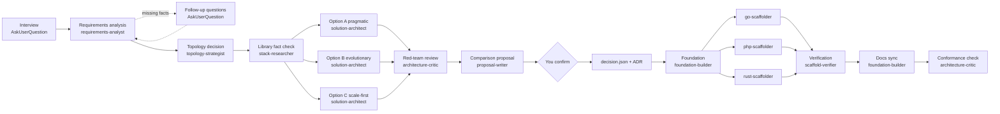

# arch-forge — architecture design workflow for Claude Code

A Claude Code plugin that **decides an application architecture from your requirements and, once you confirm it, scaffolds the project**.
Target languages: **Go / PHP / Rust**.

```
/arch-forge:design A reservation SaaS for restaurants: per-store table management, bookings, reminder notifications, and an admin console
```



## Features

- **Requirement-driven proposals**: picks layered / clean / hexagonal / DDD / vertical slice / CQRS from quality-attribute scenarios and a scale score (S/M/L/XL)
- **Microservices only when the scale warrants it**: scores team count, independent deployment, load skew and availability to choose between monolith, modular monolith and microservices, with correction rules such as "never recommend microservices first for a single team". When it splits, it designs service boundaries, data ownership, communication style and Saga / Outbox
- **Framework and library selection**: for each unit it compares candidates per role (HTTP, RPC, DB access, migrations, messaging, testing) against explicit criteria — requirement fit, architecture fit, team experience, maintenance status, performance, lock-in and scaffolding support. The choice, the runner-up, the reasons for rejecting it and the sources used to check maintenance status are recorded in the ADR. Team preferences and company standards are collected during the interview
- **Asks again when facts are missing**: you rank the top two quality attributes. If the analysis finds unknowns that would change the options (concurrent connections, order of magnitude of records and so on), it asks follow-up questions before designing
- **Library facts are checked once**: before the options are designed in parallel, the latest versions, vulnerability-free minimum versions and maintenance status are checked against primary sources (package registries, OSV, GitHub Releases), and every option cites the same table
- **Multiple options + red-team review**: designs 2–3 options with different stances in parallel, then reviews them critically for over-engineering, distributed-monolith smells, consistency risks, technology choices and unsafe defaults when a setting is missing before showing them to you. Comparison-only options are kept apart from adopt-or-reject findings, and revisions that include your adjustments are reviewed as a diff
- **Scaffolding after confirmation**: with `decision.json` as the contract, language-specific agents generate the directory layout, an end-to-end sample feature through every layer, tests, dependency-rule lint configuration (go-arch-lint / deptrac / Cargo crate split), Dockerfile and CI — and make the build and tests pass. Code generators such as sqlc and oapi-codegen are run and wired in. The go-arch-lint configuration starts from templates verified in the plugin's CI
- **Fits your machine**: even when goenv / asdf / mise shims fail, it finds the installed Go / PHP / Rust and uses them. If none is found it asks before scaffolding. Docker Compose and golangci-lint versions are checked up front
- **Build units and deploy units are separate**: units that share one go.mod (an API and a worker, for example) are scaffolded in order, shared parts first, and verified once
- **Safe defaults in production**: an unset `APP_ENV` means production, and in-memory stores or simplified modes are enabled only when a local environment is set explicitly
- **Keeps the design intact afterwards**: generated projects get `AGENTS.md` (canonical), `CLAUDE.md`, and path-scoped rules in `.claude/rules/arch-forge/`. Plugin hooks inject the confirmed architecture at session start, guard accepted ADRs, and check dependency direction right after each edit. `/arch-forge:check` re-checks everything at once
- **Runs as a workflow**: Claude Code [Workflows](https://code.claude.com/docs/en/workflows) script the sequential and parallel subagent runs in the background. Where Workflows are unavailable, the same steps run through the Agent tool

## Installation

### A. From the marketplace (recommended)

One line in Claude Code (v2.1.275 or later):

```
/plugin install arch-forge --marketplace keneanderson/claude-arch-forge
```

Or in two steps:

```
/plugin marketplace add keneanderson/claude-arch-forge
/plugin install arch-forge@arch-forge
```

Or from the CLI:

```bash
claude plugin marketplace add keneanderson/claude-arch-forge
```

```bash
claude plugin install arch-forge@arch-forge
```

### B. Clone and use

```bash
git clone https://github.com/keneanderson/claude-arch-forge.git
```

```bash
claude plugin marketplace add ./claude-arch-forge
```

```bash
claude plugin install arch-forge@arch-forge
```

To try it without installing:

```bash
claude --plugin-dir ./claude-arch-forge/plugins/arch-forge
```

### C. Roll it out to a team

Add this to the project's `.claude/settings.json`; members who trust the folder get the marketplace registered:

```json
{
  "extraKnownMarketplaces": {
    "arch-forge": {
      "source": { "source": "github", "repo": "keneanderson/claude-arch-forge" }
    }
  },
  "enabledPlugins": {
    "arch-forge@arch-forge": true
  }
}
```

Each member then runs `claude plugin install arch-forge@arch-forge --scope project`.

**Requirements**: Claude Code v2.1.323 or later. Where Workflows are disabled (`disableWorkflows`, some plans) the Agent tool is used automatically.
Verifying the generated code needs the toolchain of each language (`go` / `php` + `composer` / `cargo`). Without it, verification is reported as skipped.

## Usage

| Command | What it does |
|---|---|
| `/arch-forge:design [description of the app]` | The whole flow: interview → proposal → confirmation → scaffolding. If you stop midway, it resumes from the state of `docs/architecture/` |
| `/arch-forge:scaffold [unit...]` | Scaffolding only, from an existing confirmed `decision.json` (optionally for specific units) |
| `/arch-forge:check [path]` | Checks that the current code follows the ADRs and dependency rules |
| `/arch-forge:rules [--dry-run]` | Installs or regenerates `.claude/rules/arch-forge/` and AGENTS.md / CLAUDE.md from decision.json |

Just saying "I want to decide the architecture", "should this be microservices?" or "help me choose a framework" also starts the `design` skill.
To revisit only the frameworks after the architecture is confirmed, run `/arch-forge:design` and choose "revisit frameworks and key libraries" in the first question (the change is recorded in a new ADR).

The plugin's prompts are written in English, but it answers in your language: talk to it in another language and the questions, proposal, ADRs and the rules placed in the generated project are written in that language.

### Frameworks covered

| Language | Sample code included (◎) | Generated following the conventions (○) | Not scaffolded (×: minimal skeleton, reported as unverified) |
|---|---|---|---|
| Go | net/http, sqlc + pgx | chi, echo, gin, connect-go, grpc-go, ent, GORM, goose / golang-migrate / Atlas | fiber |
| PHP | Laravel, Pest / PHPUnit | Symfony (Doctrine), Slim 4 + PHP-DI, Laravel Octane / FrankenPHP | CakePHP, Laminas Mezzio |
| Rust | axum, sqlx | actix-web, tonic, SeaORM, diesel | poem, rocket, warp |

The selection procedure and criteria are in [frameworks.md](plugins/arch-forge/skills/architecture-patterns/references/frameworks.md).

### Generated documents

```
docs/architecture/
├── 00-brief.md            # Interview results
├── 01-requirements.md     # Quality-attribute scenarios, scale score, candidate contexts
├── 02-topology.md         # Monolith-to-microservices decision, service boundaries
├── 02b-stack-facts.md     # Latest versions, safe minimum versions and maintenance status of libraries, with primary sources
├── 03-options/            # Detailed design of each option
├── 04-review.md           # Red-team review
├── 05-proposal.md         # Comparison proposal (read this to decide)
├── decision.json          # The confirmed architecture (input to scaffolding)
├── adr/0001-application-architecture.md
├── architecture.md        # C4 diagrams
└── 07-conformance.md      # Conformance check results
```

### Conventions placed in the generated project

```
AGENTS.md                       # Canonical guide (also read by Codex, Cursor, etc.): map, units, dependency rules, commands
CLAUDE.md                       # Imports @AGENTS.md and adds Claude Code notes
.claude/rules/arch-forge/
├── common/architecture.md      # Dependency rules and how to change them (always loaded)
├── common/adr.md               # ADR process (when touching docs/architecture/**)
├── common/verification.md      # Verify before reporting completion (always)
├── go/ | php/ | rust/          # Per language (when touching *.go / *.php / *.rs)
└── units/<unit>.md             # Per unit: layer directories and how to add code (when touching that unit's path)
```

## Hooks

They run only in projects that have a `decision.json` (bash and the Python 3 standard library only; without python3 they do nothing).

| Event | Behaviour | minimal | standard (default) | strict |
|---|---|---|---|---|
| SessionStart | Injects the confirmed architecture (topology, units, entrypoints, shared build units, frameworks, conventions, ADRs). Suggests resuming if design is in progress | ✓ | ✓ | ✓ |
| PreToolUse (Write / Edit) | Editing an accepted ADR | — | Asks for confirmation | Denies |
| PreToolUse (Write / Edit) | Editing decision.json | — | Reminds you to add an ADR and re-check | Asks for confirmation |
| PostToolUse (Write / Edit) | Dependency direction of the edited .go / .php / .rs / Cargo.toml (framework imports in the domain, inner → outer, other modules' internals) | — | Warns | Blocks (asks for a fix) |
| Stop | Runs go-arch-lint / deptrac on units with changes | — | — | Sends Claude back if it fails |

Pick the profile (minimal / standard / strict / off) in the arch-forge settings under `/plugin` (`hook_profile`). To change it temporarily, set the `ARCH_FORGE_HOOK_PROFILE` environment variable.
Before the scaffolding report, `arch_hooks.py doctor` checks that the hooks can read decision.json and recognize the domain layer and detect a violation.

## Layout

```
.
├── .claude-plugin/marketplace.json
└── plugins/arch-forge/
    ├── .claude-plugin/plugin.json
    ├── skills/
    │   ├── design/                  # /arch-forge:design (orchestrator)
    │   ├── scaffold/                # /arch-forge:scaffold
    │   ├── check/                   # /arch-forge:check (delegates to the critic with context: fork)
    │   ├── rules/                   # /arch-forge:rules (install / regenerate conventions)
    │   ├── verification-before-completion/  # No completion claims without evidence (preloaded by generating / verifying agents)
    │   ├── architecture-patterns/   # Selection knowledge (patterns, decision matrix, service splitting, frameworks)
    │   ├── go-architecture/         # Go layouts and sample code
    │   ├── php-architecture/        # PHP (Laravel / Symfony / Slim)
    │   └── rust-architecture/       # Rust (Cargo workspace / axum / actix-web)
    ├── agents/                      # 11 subagents
    ├── workflows/
    │   ├── propose.js               # analysis (returns questions if facts are missing) → topology → fact check → parallel design → review → proposal
    │   └── scaffold.js              # foundation → scaffolding per build unit (shared units in order) → verification → fix → docs sync → conformance
    ├── hooks/                       # hooks.json + run-hook.sh + arch_hooks.py (doctor checks they work)
    ├── scripts/detect-toolchains.sh # Finds Go / PHP / Rust and helper tools (goenv / asdf / mise / Homebrew)
    ├── rules/                       # Conventions placed in generated projects (common / go / php / rust)
    └── templates/
        ├── decision.schema.json     # The contract between design and scaffold
        ├── adr.md
        ├── AGENTS.md / CLAUDE.md    # Entry points of the generated project
        ├── unit-rule.md             # Template for per-unit rules
        └── go/go-arch-lint.*.yml    # Verified go-arch-lint configs (clean / modular-monolith)
```

### Subagents

| Agent | Model | Effort | Tools | Role |
|---|---|---|---|---|
| requirements-analyst | sonnet | medium | Read, Glob, Grep, Write | Structures requirements, scale score |
| topology-strategist | opus | high | Read, Glob, Grep, Write, WebSearch | Monolith vs. microservices, service boundaries |
| stack-researcher | sonnet | medium | Read, Glob, Grep, Write, WebFetch, WebSearch | Checks latest versions, safe minimum versions and maintenance status against primary sources |
| solution-architect | opus | high | Read, Glob, Grep, Write, Edit, WebSearch, WebFetch | One architecture option per stance, framework, library and package layout selection |
| architecture-critic | sonnet | high | Read, Glob, Grep, Write, Bash | Red-team review (including technology choices), conformance check |
| proposal-writer | sonnet | medium | Read, Glob, Write | Comparison proposal, decision draft |
| foundation-builder | sonnet | medium | Read, Write, Edit, Glob, Grep, Bash | Root layout, contracts, CI, AGENTS.md / CLAUDE.md, rules |
| go-scaffolder | sonnet | medium | Read, Write, Edit, Glob, Grep, Bash | Go units |
| php-scaffolder | sonnet | medium | Read, Write, Edit, Glob, Grep, Bash | PHP units |
| rust-scaffolder | sonnet | medium | Read, Write, Edit, Glob, Grep, Bash | Rust units |
| scaffold-verifier | haiku | low | Read, Glob, Grep, Bash | Runs fmt / lint / build / test and reports |

Opus handles the design steps where judgement decides the outcome, Sonnet handles generation and synthesis, and Haiku runs the verification commands.
Models are set both in each agent's frontmatter and in the `agent()` calls inside the workflows.
The generating and verifying agents (foundation-builder, each scaffolder, scaffold-verifier, architecture-critic) preload the `verification-before-completion` skill and report the verification commands they ran as evidence.

## Customization

- To align with your company's patterns and libraries, edit `skills/*-architecture/references/`; framework candidates and criteria live in `skills/architecture-patterns/references/frameworks.md`
- Scale thresholds: `skills/architecture-patterns/references/decision-matrix.md`
- To lower cost, change each agent's `model:` and the `model` passed to `agent()` in `workflows/*.js`
- Conventions for generated projects live in `rules/` (aim for at most 80 lines per file; see `rules/README.md`)

## Development

Contributor conventions are in [AGENTS.md](AGENTS.md). Run the quality gate before pushing:

```bash
make validate
```

It checks JSON, versions, frontmatter and rules, runs the workflows against mocks, runs the hook tests, checks the toolchain detection script, verifies the go-arch-lint templates (when Go is available), and runs `claude plugin validate`.

## License

MIT
