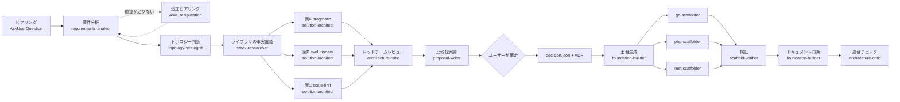

# arch-forge — Claude Code アーキテクチャ設計ワークフロー

[English](README.en.md) | 日本語

新規開発のアプリケーションアーキテクチャを **要件から決めて、確定したらそのまま雛形まで作る** Claude Code プラグインです。
対象言語は **Go / PHP / Rust**。

```
/arch-forge:design 飲食店向けの予約管理 SaaS。店舗ごとの席管理と予約、リマインド通知、管理画面
```



## 特徴

- **要件に沿った提案**: 品質特性シナリオと規模スコア（S/M/L/XL）から、レイヤード / クリーン / ヘキサゴナル / DDD / バーティカルスライス / CQRS を選定
- **規模に応じたマイクロサービス判断**: チーム数・独立デプロイ・負荷差・可用性をスコア化し、モノリス / モジュラーモノリス / マイクロサービスを判断。「1 チームならマイクロサービスを第一推奨にしない」などの補正ルール付き。分割時はサービス境界・データ所有・通信方式・Saga/Outbox まで設計
- **フレームワーク・主要ライブラリの選定**: ユニットごとに HTTP / RPC / DB アクセス / マイグレーション / メッセージング / テストの役割別に候補を比較（要件適合、アーキテクチャ適合、チームの経験、保守状況、性能、ロックイン、生成サポート）。採用・次点・却下理由と保守状況の出典を ADR に残す。チームの経験や社内標準の指定もヒアリングで受け付ける
- **前提が足りなければ聞き直す**: 品質特性は 1 位・2 位を選んでもらう。要件分析で、答えによって案が変わる未知の項目（同時接続数、件数の桁など）が出たら、設計に進む前に追加で質問する
- **ライブラリの事実は 1 回だけ確認**: 案を並列に設計する前に、最新版・既知の脆弱性を含まない下限・保守状況を一次情報（パッケージレジストリ、OSV、GitHub Releases）で確認し、全案が同じ表を引用する
- **複数案 + レッドチームレビュー**: 方針の異なる 2〜3 案を並列に設計し、過剰設計・分散モノリス化・整合性リスク・設定漏れ時の危険な既定値を批判的にレビューしてから提示。比較用の案は採用可否の指摘と分けて扱い、ユーザーの調整を入れた改訂も差分だけレビューする
- **確定したら雛形を生成**: decision.json を契約として、言語別エージェントがディレクトリ・全層を貫通するサンプル機能・テスト・依存方向 lint 設定（go-arch-lint / deptrac / Cargo crate 分割）・Dockerfile・CI を生成し、ビルドとテストまで通す。sqlc / oapi-codegen などのコード生成も実行して配線する。go-arch-lint の設定はプラグインの CI で検証済みのテンプレートから作る
- **手元の環境に合わせる**: goenv / asdf / mise のシムが失敗しても、インストール済みの Go / PHP / Rust の実体を探して使う。見つからなければ生成の前に確認する。Docker Compose や golangci-lint の版も事前に確認する
- **ビルド単位とデプロイ単位を分けて扱う**: API と worker のように 1 つの go.mod を共有するユニットは、共通部分を先に作ってから起動点を順番に足し、検証を 1 回にまとめる
- **本番で安全な既定値**: `APP_ENV` の未設定は本番として扱い、インメモリ実装や簡易モードはローカル環境を明示したときだけ有効にする
- **生成後も設計を守る**: 生成プロジェクトに `AGENTS.md`（正本）と `CLAUDE.md`、パス指定付きの依存ルール `.claude/rules/arch-forge/` を置く。さらにプラグインの hooks が、セッション開始時の文脈注入・承認済み ADR の保護・編集直後の依存方向チェックを行う。`/arch-forge:check` で違反をまとめて再検査
- **ワークフローで実行**: Claude Code の [Workflows](https://code.claude.com/docs/en/workflows) で、サブエージェントの直列・並列実行をスクリプト化（バックグラウンド実行）。Workflows が使えない環境では Agent ツールで同じ順序にフォールバック

## インストール

### A. マーケットプレイスから（推奨）

Claude Code で 1 行（v2.1.275 以降）:

```
/plugin install arch-forge --marketplace keneanderson/claude-arch-forge
```

または 2 ステップで:

```
/plugin marketplace add keneanderson/claude-arch-forge
/plugin install arch-forge@arch-forge
```

または CLI で:

```bash
claude plugin marketplace add keneanderson/claude-arch-forge
```

```bash
claude plugin install arch-forge@arch-forge
```

### B. clone して使う

```bash
git clone https://github.com/keneanderson/claude-arch-forge.git
```

```bash
claude plugin marketplace add ./claude-arch-forge
```

```bash
claude plugin install arch-forge@arch-forge
```

一時的に試すだけなら、インストールせずに読み込めます:

```bash
claude --plugin-dir ./claude-arch-forge/plugins/arch-forge
```

### C. チーム全員に配布する

プロジェクトの `.claude/settings.json` に追加すると、フォルダを信頼したメンバーにマーケットプレイスが登録されます:

```json
{
  "extraKnownMarketplaces": {
    "arch-forge": {
      "source": { "source": "github", "repo": "keneanderson/claude-arch-forge" }
    }
  },
  "enabledPlugins": {
    "arch-forge@arch-forge": true
  }
}
```

各メンバーは `claude plugin install arch-forge@arch-forge --scope project` でインストールします。

**動作要件**: Claude Code v2.1.323 以上。Workflows が無効な環境（`disableWorkflows`、一部プラン）では自動的に Agent ツールで実行します。
生成したコードのビルド検証には、使う言語のツールチェーン（`go` / `php` + `composer` / `cargo`）が必要です。無い場合は検証を skipped として報告します。

## 使い方

| コマンド | 内容 |
|---|---|
| `/arch-forge:design [アプリの説明]` | ヒアリング → 提案 → 確定 → 生成 までの全工程。途中で止めても `docs/architecture/` の状態から再開 |
| `/arch-forge:scaffold [ユニット名...]` | 確定済みの `decision.json` から生成だけを実行（特定ユニットのみも可） |
| `/arch-forge:check [パス]` | 現在のコードが ADR・依存ルールに従っているか検査 |
| `/arch-forge:rules [--dry-run]` | decision.json から `.claude/rules/arch-forge/` と AGENTS.md / CLAUDE.md を導入・再生成 |

「アーキテクチャを決めたい」「マイクロサービスにすべき？」「フレームワークを選びたい」と話しかけるだけでも `design` スキルが起動します。
確定後にフレームワークだけ見直したい場合も `/arch-forge:design` を実行し、最初の選択肢で「フレームワーク・主要ライブラリを見直す」を選びます（新しい ADR で置き換えます）。

英語で話しかければ、質問・提案書・ADR・生成プロジェクトの規約も英語で作られます。

### フレームワーク選定の対象

| 言語 | 雛形のサンプルあり（◎） | 規約どおり生成（○） | 生成対象外（×、選ぶと最小構成で未検証） |
|---|---|---|---|
| Go | net/http、sqlc + pgx | chi、echo、gin、connect-go、grpc-go、ent、GORM、goose / golang-migrate / Atlas | fiber |
| PHP | Laravel、Pest / PHPUnit | Symfony（Doctrine）、Slim 4 + PHP-DI、Laravel Octane / FrankenPHP | CakePHP、Laminas Mezzio |
| Rust | axum、sqlx | actix-web、tonic、SeaORM、diesel | poem、rocket、warp |

選定手順と評価軸は [frameworks.md](plugins/arch-forge/skills/architecture-patterns/references/frameworks.md) にあります。

### 生成されるドキュメント

```
docs/architecture/
├── 00-brief.md            # ヒアリング結果
├── 01-requirements.md     # 品質特性シナリオ、規模スコア、コンテキスト候補
├── 02-topology.md         # モノリス〜マイクロサービスの判断、サービス境界
├── 02b-stack-facts.md     # ライブラリの最新版・安全な下限・保守状況（一次情報の出典付き）
├── 03-options/            # 案ごとの詳細設計
├── 04-review.md           # レッドチームレビュー
├── 05-proposal.md         # 比較提案書（ここを読んで決める）
├── decision.json          # 確定したアーキテクチャ（生成の入力）
├── adr/0001-application-architecture.md
├── architecture.md        # C4 図
└── 07-conformance.md      # 適合チェック結果
```

### 生成プロジェクトに置かれる規約

```
AGENTS.md                       # 正本（Codex / Cursor なども読む）。地図・ユニット表・依存ルール要約・コマンド
CLAUDE.md                       # @AGENTS.md を読み込み、Claude Code 向けの補足
.claude/rules/arch-forge/
├── common/architecture.md      # 依存ルール・変更手順（常時読み込み）
├── common/adr.md               # ADR の運用（docs/architecture/** を扱うとき）
├── common/verification.md      # 完了報告の前に検証する（常時）
├── go/ | php/ | rust/          # 言語別（*.go / *.php / *.rs を扱うとき）
└── units/<unit>.md             # ユニット別の層ディレクトリと追加手順（そのユニットのパスを扱うとき）
```

## Hooks

decision.json があるプロジェクトでだけ動きます（bash と python3 標準ライブラリのみ。python3 が無ければ何もしません）。

| イベント | 動作 | minimal | standard（既定） | strict |
|---|---|---|---|---|
| SessionStart | 確定アーキテクチャ（トポロジー・ユニット・起動点・共有するビルド単位・フレームワーク・実装規約・ADR）を文脈に注入。設計途中なら再開を案内 | ✓ | ✓ | ✓ |
| PreToolUse（Write / Edit） | 承認済み ADR の書き換え | — | 確認を求める | 拒否 |
| PreToolUse（Write / Edit） | decision.json の書き換え | — | ADR 追加と再検査を促す | 確認を求める |
| PostToolUse（Write / Edit） | 編集した .go / .php / .rs / Cargo.toml の依存方向（domain のフレームワーク依存、内側→外側、他モジュールの内部参照） | — | 警告 | ブロック（修正を促す） |
| Stop | 変更のあるユニットで go-arch-lint / deptrac を実行 | — | — | 失敗なら差し戻し |

プロファイルは `/plugin` の arch-forge の設定（`hook_profile`）で minimal / standard / strict / off から選べます。一時的に変えるときは環境変数 `ARCH_FORGE_HOOK_PROFILE` を使います。
生成の完了報告の前に `arch_hooks.py doctor` で、decision.json を読めるか・ドメイン層を認識して違反を検出できるかを確認します。

## 構成

```
.
├── .claude-plugin/marketplace.json
└── plugins/arch-forge/
    ├── .claude-plugin/plugin.json
    ├── skills/
    │   ├── design/                  # /arch-forge:design（オーケストレーター）
    │   ├── scaffold/                # /arch-forge:scaffold
    │   ├── check/                   # /arch-forge:check（context: fork で critic に委譲）
    │   ├── rules/                   # /arch-forge:rules（規約の導入・再生成）
    │   ├── verification-before-completion/  # 証拠なしに完了と言わない（生成・検証系エージェントに preload）
    │   ├── architecture-patterns/   # 選定ナレッジ（パターン、意思決定マトリクス、サービス分割、フレームワーク選定）
    │   ├── go-architecture/         # Go の構成とサンプルコード
    │   ├── php-architecture/        # PHP（Laravel / Symfony / Slim）
    │   └── rust-architecture/       # Rust（Cargo workspace / axum）
    ├── agents/                      # 11 のサブエージェント
    ├── workflows/
    │   ├── propose.js               # 分析（前提不足なら質問を返す）→ トポロジー → 事実確認 → 並列設計 → レビュー → 提案
    │   └── scaffold.js              # 土台 → ビルド単位ごとに生成（共有するユニットは順番）→ 検証 → 修正 → ドキュメント同期 → 適合チェック
    ├── hooks/                       # hooks.json + run-hook.sh + arch_hooks.py（doctor で動作確認）
    ├── scripts/detect-toolchains.sh # Go / PHP / Rust と補助ツールの実体を探す（goenv / asdf / mise / Homebrew）
    ├── rules/                       # 生成プロジェクトに置く規約（common / go / php / rust）
    └── templates/
        ├── decision.schema.json     # design と scaffold をつなぐ契約
        ├── adr.md
        ├── AGENTS.md / CLAUDE.md    # 生成プロジェクトの入口
        ├── unit-rule.md             # ユニット別ルールの雛形
        └── go/go-arch-lint.*.yml    # 検証済みの go-arch-lint 設定（clean / modular-monolith）
```

### サブエージェント

| エージェント | モデル | effort | ツール | 役割 |
|---|---|---|---|---|
| requirements-analyst | sonnet | medium | Read, Glob, Grep, Write | 要件の構造化、規模スコア |
| topology-strategist | opus | high | Read, Glob, Grep, Write, WebSearch | モノリス / マイクロサービス判断、サービス境界 |
| stack-researcher | sonnet | medium | Read, Glob, Grep, Write, WebFetch, WebSearch | ライブラリの最新版・安全な下限・保守状況を一次情報で確認 |
| solution-architect | opus | high | Read, Glob, Grep, Write, Edit, WebSearch, WebFetch | 方針別のアーキテクチャ案、フレームワーク・主要ライブラリ・パッケージの分け方の選定 |
| architecture-critic | sonnet | high | Read, Glob, Grep, Write, Bash | レッドチームレビュー（技術選定を含む）、適合チェック |
| proposal-writer | sonnet | medium | Read, Glob, Write | 比較提案書、decision ドラフト |
| foundation-builder | sonnet | medium | Read, Write, Edit, Glob, Grep, Bash | ルート構成、契約、CI、AGENTS.md / CLAUDE.md、rules |
| go-scaffolder | sonnet | medium | Read, Write, Edit, Glob, Grep, Bash | Go ユニット生成 |
| php-scaffolder | sonnet | medium | Read, Write, Edit, Glob, Grep, Bash | PHP ユニット生成 |
| rust-scaffolder | sonnet | medium | Read, Write, Edit, Glob, Grep, Bash | Rust ユニット生成 |
| scaffold-verifier | haiku | low | Read, Glob, Grep, Bash | fmt / lint / build / test の実行と報告 |

判断の質が結果を左右する設計工程に opus、生成・統合に sonnet、コマンド実行だけの検証に haiku を割り当てています。
モデルは各エージェントの frontmatter と、ワークフロー内の `agent()` 呼び出しの両方で指定しています。
生成・検証系（foundation-builder、各 scaffolder、scaffold-verifier、architecture-critic）は `verification-before-completion` スキルを preload し、実行した検証コマンドを証拠として報告します。

## カスタマイズ

- 社内標準のパターンやライブラリに寄せたい場合は `skills/*-architecture/references/` を、フレームワークの候補と評価軸は `skills/architecture-patterns/references/frameworks.md` を編集してください
- 規模判定の閾値は `skills/architecture-patterns/references/decision-matrix.md`
- コストを下げたい場合はエージェントの `model:` と、`workflows/*.js` の `agent()` に渡している `model` を変更します
- 生成プロジェクトの規約は `rules/` を編集します（1 ファイル 80 行以内が目安。書き方は `rules/README.md`）

## 開発

開発時の規約は [AGENTS.md](AGENTS.md) にあります。push 前に品質ゲートを実行してください。

```bash
make validate
```

JSON・版数・frontmatter・rules の検査、workflow のモック実行、hooks のテスト、ツールチェーン検出スクリプトの確認、go-arch-lint テンプレートの検証（Go がある場合）、`claude plugin validate` をまとめて行います。

## License

MIT

