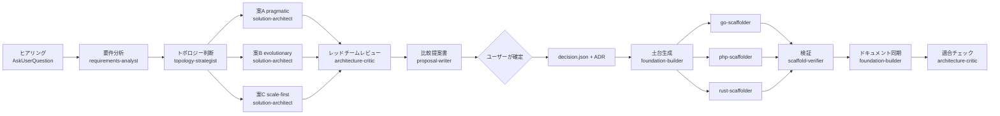

# arch-forge — Claude Code アーキテクチャ設計ワークフロー

新規開発のアプリケーションアーキテクチャを **要件から決めて、確定したらそのまま雛形まで作る** Claude Code プラグインです。
対象言語は **Go / PHP / Rust**。

```
/arch-forge:design 飲食店向けの予約管理 SaaS。店舗ごとの席管理と予約、リマインド通知、管理画面
```



## 特徴

- **要件に沿った提案**: 品質特性シナリオと規模スコア（S/M/L/XL）から、レイヤード / クリーン / ヘキサゴナル / DDD / バーティカルスライス / CQRS を選定
- **規模に応じたマイクロサービス判断**: チーム数・独立デプロイ・負荷差・可用性をスコア化し、モノリス / モジュラーモノリス / マイクロサービスを判断。「1 チームならマイクロサービスを第一推奨にしない」などの補正ルール付き。分割時はサービス境界・データ所有・通信方式・Saga/Outbox まで設計
- **複数案 + レッドチームレビュー**: 方針の異なる 2〜3 案を並列に設計し、過剰設計・分散モノリス化・整合性リスクを批判的にレビューしてから提示
- **確定したら雛形を生成**: decision.json を契約として、言語別エージェントがディレクトリ・全層を貫通するサンプル機能・テスト・依存方向 lint 設定（go-arch-lint / deptrac / Cargo crate 分割）・Dockerfile・CI を生成し、ビルドとテストまで通す
- **生成後も設計を守る**: 生成プロジェクトのルートに依存ルールを書いた `CLAUDE.md` と ADR を置くので、以降の Claude Code セッションもアーキテクチャに従う。`/arch-forge:check` で違反を再検査
- **ワークフローで実行**: Claude Code の [Workflows](https://code.claude.com/docs/en/workflows) で、サブエージェントの直列・並列実行をスクリプト化（バックグラウンド実行）。Workflows が使えない環境では Agent ツールで同じ順序にフォールバック

## インストール

### A. マーケットプレイスから（推奨）

Claude Code で 1 行（v2.1.275 以降）:

```
/plugin install arch-forge --marketplace keneanderson/claude-arch-forge
```

または 2 ステップで:

```
/plugin marketplace add keneanderson/claude-arch-forge
/plugin install arch-forge@arch-forge
```

または CLI で:

```bash
claude plugin marketplace add keneanderson/claude-arch-forge
```

```bash
claude plugin install arch-forge@arch-forge
```

### B. clone して使う

```bash
git clone https://github.com/keneanderson/claude-arch-forge.git
```

```bash
claude plugin marketplace add ./claude-arch-forge
```

```bash
claude plugin install arch-forge@arch-forge
```

一時的に試すだけなら、インストールせずに読み込めます:

```bash
claude --plugin-dir ./claude-arch-forge/plugins/arch-forge
```

### C. チーム全員に配布する

プロジェクトの `.claude/settings.json` に追加すると、フォルダを信頼したメンバーにマーケットプレイスが登録されます:

```json
{
  "extraKnownMarketplaces": {
    "arch-forge": {
      "source": { "source": "github", "repo": "keneanderson/claude-arch-forge" }
    }
  },
  "enabledPlugins": {
    "arch-forge@arch-forge": true
  }
}
```

各メンバーは `claude plugin install arch-forge@arch-forge --scope project` でインストールします。

**動作要件**: Claude Code v2.1.323 以上。Workflows が無効な環境（`disableWorkflows`、一部プラン）では自動的に Agent ツールで実行します。
生成したコードのビルド検証には、使う言語のツールチェーン（`go` / `php` + `composer` / `cargo`）が必要です。無い場合は検証を skipped として報告します。

## 使い方

| コマンド | 内容 |
|---|---|
| `/arch-forge:design [アプリの説明]` | ヒアリング → 提案 → 確定 → 生成 までの全工程。途中で止めても `docs/architecture/` の状態から再開 |
| `/arch-forge:scaffold [ユニット名...]` | 確定済みの `decision.json` から生成だけを実行（特定ユニットのみも可） |
| `/arch-forge:check [パス]` | 現在のコードが ADR・依存ルールに従っているか検査 |

「アーキテクチャを決めたい」「マイクロサービスにすべき？」と話しかけるだけでも `design` スキルが起動します。

### 生成されるドキュメント

```
docs/architecture/
├── 00-brief.md            # ヒアリング結果
├── 01-requirements.md     # 品質特性シナリオ、規模スコア、コンテキスト候補
├── 02-topology.md         # モノリス〜マイクロサービスの判断、サービス境界
├── 03-options/            # 案ごとの詳細設計
├── 04-review.md           # レッドチームレビュー
├── 05-proposal.md         # 比較提案書（ここを読んで決める）
├── decision.json          # 確定したアーキテクチャ（生成の入力）
├── adr/0001-application-architecture.md
├── architecture.md        # C4 図
└── 07-conformance.md      # 適合チェック結果
```

## 構成

```
.
├── .claude-plugin/marketplace.json
└── plugins/arch-forge/
    ├── .claude-plugin/plugin.json
    ├── skills/
    │   ├── design/                  # /arch-forge:design（オーケストレーター）
    │   ├── scaffold/                # /arch-forge:scaffold
    │   ├── check/                   # /arch-forge:check（context: fork で critic に委譲）
    │   ├── architecture-patterns/   # 選定ナレッジ（パターン、意思決定マトリクス、サービス分割）
    │   ├── go-architecture/         # Go の構成とサンプルコード
    │   ├── php-architecture/        # PHP（Laravel / Symfony / Slim）
    │   └── rust-architecture/       # Rust（Cargo workspace / axum）
    ├── agents/                      # 10 のサブエージェント
    ├── workflows/
    │   ├── propose.js               # 分析 → トポロジー → 並列設計 → レビュー → 提案
    │   └── scaffold.js              # 土台 → ユニット並列生成 → 検証 → 修正 → ドキュメント同期 → 適合チェック
    └── templates/
        ├── decision.schema.json     # design と scaffold をつなぐ契約
        └── adr.md
```

### サブエージェント

| エージェント | モデル | effort | ツール | 役割 |
|---|---|---|---|---|
| requirements-analyst | sonnet | medium | Read, Glob, Grep, Write | 要件の構造化、規模スコア |
| topology-strategist | opus | high | Read, Glob, Grep, Write, WebSearch | モノリス / マイクロサービス判断、サービス境界 |
| solution-architect | opus | high | Read, Glob, Grep, Write, WebSearch, WebFetch | 方針別のアーキテクチャ案 |
| architecture-critic | sonnet | high | Read, Glob, Grep, Write, Bash | レッドチームレビュー、適合チェック |
| proposal-writer | sonnet | medium | Read, Glob, Write | 比較提案書、decision ドラフト |
| foundation-builder | sonnet | medium | Read, Write, Edit, Glob, Grep, Bash | ルート構成、契約、CI、CLAUDE.md |
| go-scaffolder | sonnet | medium | Read, Write, Edit, Glob, Grep, Bash | Go ユニット生成 |
| php-scaffolder | sonnet | medium | Read, Write, Edit, Glob, Grep, Bash | PHP ユニット生成 |
| rust-scaffolder | sonnet | medium | Read, Write, Edit, Glob, Grep, Bash | Rust ユニット生成 |
| scaffold-verifier | haiku | low | Read, Glob, Grep, Bash | fmt / lint / build / test の実行と報告 |

判断の質が結果を左右する設計工程に opus、生成・統合に sonnet、コマンド実行だけの検証に haiku を割り当てています。
モデルは各エージェントの frontmatter と、ワークフロー内の `agent()` 呼び出しの両方で指定しています。

## カスタマイズ

- 社内標準のパターンやライブラリに寄せたい場合は `skills/*-architecture/references/` を編集してください
- 規模判定の閾値は `skills/architecture-patterns/references/decision-matrix.md`
- コストを下げたい場合はエージェントの `model:` と、`workflows/*.js` の `agent()` に渡している `model` を変更します

## 開発

```bash
claude plugin validate . && claude plugin validate plugins/arch-forge --strict
```

## License

MIT

---

## English summary

**arch-forge** is a Claude Code plugin that decides an application architecture from requirements and then scaffolds it, for **Go, PHP and Rust**.
`/arch-forge:design` interviews you, runs a background workflow (requirements analysis → monolith / modular monolith / microservices decision → 2–3 parallel architecture options → red-team review → comparison proposal), lets you confirm a choice, writes an ADR and `decision.json`, then generates the directory layout and an end-to-end sample feature with tests, dependency-rule linting (go-arch-lint / deptrac / Cargo crates), Docker and CI, and verifies the build.
Install with `/plugin marketplace add keneanderson/claude-arch-forge` and `/plugin install arch-forge@arch-forge`.
